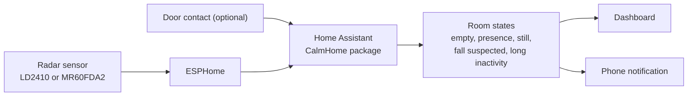

# CalmHome Sensor

[English](README.md) | [한국어](docs/README.ko.md) | [日本語](docs/README.ja.md) | [中文](docs/README.zh-CN.md)

Privacy-first Home Assistant and ESPHome configuration for room-level presence and safety status monitoring. CalmHome reports simple states such as presence, movement, suspected falls, long inactivity, and door opening without cameras, microphones, identity recognition, or router-based sensing.

> **Safety notice:** This is a beta home-status aid, not a medical device, emergency service, or guaranteed fall detector. Validate every sensor and notification in the target room and keep an independent way to request help.



No cameras or microphones. You can try every state in mock mode before buying any hardware.

## Privacy and safety boundaries

- Use only with the informed consent of everyone who may enter the monitored space.
- Processing is designed to remain in Home Assistant and ESPHome on your local network.
- The router provides network transport only; this project does not sniff Wi-Fi traffic or use through-wall/router sensing.
- Camera, microphone, face/identity recognition, silhouettes, raw radar point clouds, credential capture, and public port forwarding are outside the project scope.
- Keep diagnostic entities disabled during normal use. Never commit Wi-Fi credentials, API keys, personal entity IDs, or room-specific notes.
- For remote access, use a VPN such as Tailscale or Home Assistant Cloud rather than exposing Home Assistant directly to the internet.

See [the privacy model](docs/PRIVACY.md) and [runtime test plan](docs/RUNTIME_TEST_PLAN.md) before deployment.

## Requirements

- A Home Assistant host (for example, Home Assistant Green, a Raspberry Pi, or a mini PC)
- An ESPHome-compatible presence sensor; supported examples are documented in [the hardware guide](docs/HARDWARE.md)
- Optional fall-status, PIR, or door-contact sensors
- Python 3 with the packages in `requirements.txt` for local validation

Real hardware behavior depends on sensor placement, room layout, firmware, and calibration. The repository includes mock mode so you can test without physical sensors first.

## Quick start

```bash
python -m pip install -r requirements.txt
python scripts/validate_configs.py
python -m pytest tests
python scripts/simulate_events.py normal_activity
python scripts/simulate_events.py fall_suspected
```

Then:

1. Add `homeassistant/packages/calmhome.yaml` and `homeassistant/packages/calmhome_mock.yaml` to Home Assistant.
2. Enable mock mode and test `room_empty`, `presence_detected`, `movement_detected`, `still_presence`, `fall_suspected`, `long_inactivity`, and `door_opened`.
3. Choose and adapt an example from `esphome/`.
4. Copy `config/entities.local.example.yaml` to the ignored `config/entities.local.yaml`, then map real entity IDs from Home Assistant Developer Tools.
5. Import or recreate `dashboards/calmhome_dashboard.yaml`.
6. Follow the [Home Assistant](docs/INSTALL_HOME_ASSISTANT.md), [ESPHome](docs/INSTALL_ESPHOME.md), [placement](docs/SENSOR_PLACEMENT.md), and [runtime testing](docs/RUNTIME_TEST_PLAN.md) guides before enabling notifications.

PowerShell users can copy the local mapping template with:

```powershell
Copy-Item config/entities.local.example.yaml config/entities.local.yaml
```

## What is included

```text
config/                 Logical and local entity mapping templates
dashboards/             Home Assistant dashboard YAML
docs/                   Installation, hardware, privacy, placement, and test guides
esphome/                ESPHome example configurations
homeassistant/packages/ Home Assistant production and mock packages
scripts/                Simulation and configuration validation utilities
tests/                  Pytest validation suite
```

## Limitations

- Physical hardware has not been validated for every room or listed sensor; test in place before relying on alerts.
- A `fall suspected` or `long inactivity` state can be a false positive or false negative.
- State summaries do not identify a person or explain why an event occurred.
- Moving furniture, curtains, fans, or sensors can change detection behavior and requires retesting.
- This project does not replace direct check-ins, professional care, smoke/CO alarms, or emergency systems.

## Attribution

If you share a fork, demo, article, or derivative, a courteous mention of [@Bum-Boo](https://github.com/Bum-Boo) and the [original repository](https://github.com/Bum-Boo/calmhome-sensor) is appreciated. This is a request for credit, not an additional license condition or restriction.
