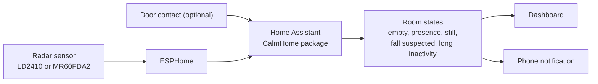

# CalmHome Sensor

[English](README.md) | [한국어](docs/README.ko.md) | [日本語](docs/README.ja.md) | [中文](docs/README.zh-CN.md)

Privacy-first Home Assistant and ESPHome configuration for room-level presence and safety status monitoring. CalmHome reports simple states such as presence, movement, suspected falls, long inactivity, and door opening without cameras, microphones, identity recognition, or router-based sensing.

> **Safety notice:** This is a beta home-status aid, not a medical device, emergency service, or guaranteed fall detector. Validate every sensor and notification in the target room and keep an independent way to request help.



No cameras or microphones. You can try every state, including sensor offline, in mock mode before buying any hardware.

## Privacy and safety boundaries

- Use only with the informed consent of everyone who may enter the monitored space.
- Processing is designed to remain in Home Assistant and ESPHome on your local network.
- The router provides network transport only; this project does not sniff Wi-Fi traffic or use through-wall/router sensing.
- Camera, microphone, face/identity recognition, silhouettes, raw radar point clouds, credential capture, and public port forwarding are outside the project scope.
- Keep diagnostic entities disabled during normal use. Never commit Wi-Fi credentials, API keys, personal entity IDs, or room-specific notes.
- For remote access, use a VPN such as Tailscale or Home Assistant Cloud rather than exposing Home Assistant directly to the internet.

See [the privacy model](docs/PRIVACY.md) and [runtime test plan](docs/RUNTIME_TEST_PLAN.md) before deployment.

## Requirements

What you need depends on how far you go:

| Step | Needs |
| --- | --- |
| Validate configs, run tests and the simulators | Python 3 with `requirements.txt`; `Jinja2` for the template simulator tests |
| Try the dashboard and automations in mock mode | A Home Assistant host (for example, Home Assistant Green, a Raspberry Pi, or a mini PC) |
| Real room status | An ESPHome-compatible presence sensor (see [the hardware guide](docs/HARDWARE.md)); optional fall-status, PIR, or door-contact sensors |

Real hardware behavior depends on sensor placement, room layout, firmware, and calibration.

## Quick start

### 1. On your computer (no Home Assistant, no hardware)

```bash
python -m pip install -r requirements.txt
python -m pip install Jinja2   # optional: enables the template simulator and its tests
python scripts/validate_configs.py
python -m pytest tests
python scripts/simulate_events.py fall_suspected
python scripts/presence_sim.py --list
python scripts/presence_sim.py sensor_dropout
```

- `validate_configs.py` parses every YAML file and checks the mapping files (including your private `config/entities.local.yaml` if it exists), mock scenarios, notification automations, template options Home Assistant rejects, and privacy guardrails.
- `simulate_events.py` prints the room state for already-debounced states.
- `presence_sim.py` replays synthetic radar streams (empty room, still person, movement, fall-like, dropout, noisy readings, conflicting sensors) through the package's own templates with debounce and delays. Without Jinja2 those tests are skipped.
- Optional, slower: `scripts/ha_runtime_check.py` boots a real Home Assistant core with the packages. Install `homeassistant` in a separate virtual environment first (see the script header).

### 2. In Home Assistant with mock mode (no sensors yet)

1. Add `homeassistant/packages/calmhome.yaml` and `homeassistant/packages/calmhome_mock.yaml` to Home Assistant ([guide](docs/INSTALL_HOME_ASSISTANT.md)), then restart.
2. Until real sensors are mapped, the room state shows `sensor offline`. That is expected.
3. Turn on mock mode and test `room_empty`, `presence_detected`, `movement_detected`, `still_presence`, `fall_suspected`, `long_inactivity`, `door_opened`, and `sensor_offline`.
4. Import or recreate `dashboards/calmhome_dashboard.yaml`.

### 3. With real hardware

1. Choose and adapt an example from `esphome/`, then flash and add the device ([guide](docs/INSTALL_ESPHOME.md)).
2. Find the real entity IDs in Developer Tools > States. Home Assistant usually prefixes ESPHome entity IDs with the device name, so they rarely match the package defaults.
3. Put those IDs in the `initial:` values of the `input_text` helpers in `calmhome.yaml`. Changes made only in the UI are reset on restart. Optionally keep a private note in `config/entities.local.yaml` (copied from `config/entities.local.example.yaml`; Home Assistant does not read it, `validate_configs.py` checks it).
4. Follow the [placement](docs/SENSOR_PLACEMENT.md) and [runtime testing](docs/RUNTIME_TEST_PLAN.md) guides before enabling notifications.

PowerShell users can copy the local mapping template with:

```powershell
Copy-Item config/entities.local.example.yaml config/entities.local.yaml
```

## What is included

```text
config/                 Logical and local entity mapping templates
dashboards/             Home Assistant dashboard YAML
docs/                   Installation, hardware, privacy, placement, and test guides
esphome/                ESPHome example configurations
homeassistant/packages/ Home Assistant production and mock packages
scripts/                Simulation and configuration validation utilities
tests/                  Pytest validation suite
```

## Limitations

- Physical hardware has not been validated for every room or listed sensor; test in place before relying on alerts.
- A `fall suspected` or `long inactivity` state can be a false positive or false negative.
- `sensor offline` relies on the device going unavailable in Home Assistant. A radar module that stops updating while its ESP32 stays connected keeps reporting its last value and is not detected as stale.
- Long inactivity means no recorded presence, movement, or still-presence change for the threshold while the room is occupied. Noisy presence readings count as activity and can delay it.
- State summaries do not identify a person or explain why an event occurred.
- Moving furniture, curtains, fans, or sensors can change detection behavior and requires retesting.
- This project does not replace direct check-ins, professional care, smoke/CO alarms, or emergency systems.

## Attribution

If you share a fork, demo, article, or derivative, a courteous mention of [@Bum-Boo](https://github.com/Bum-Boo) and the [original repository](https://github.com/Bum-Boo/calmhome-sensor) is appreciated. This is a request for credit, not an additional license condition or restriction.

## License

[MIT](LICENSE)
